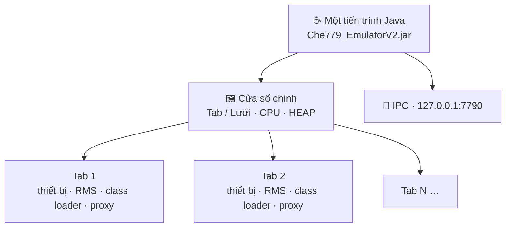

<div align="center">

# 🗂️ Che779 Emulator V2

**Giả lập J2ME nhiều tab trong một cửa sổ — một tiến trình Java, không cần chương trình điều khiển riêng.**

Dựa trên MicroEmulator 3.0.0, thêm lớp Che779: tab, lưới, proxy theo tab, đồng bộ thao tác và dọn RAM.
Mở lên là dùng trên Windows.

> **Nền tảng: Windows.** Quy ước 4 repo: **P1 và P2 = Windows · P3 = Linux · P4 = Android (kèm Termux)**. Bản Linux (gói `.deb`/`.tar.gz`, gồm V2) nằm ở [Che779-Linux](https://github.com/Kidtomboy/Che779-Linux).

[](../../releases/latest)
[](../../releases)
[](../../actions)
[](#-tải-về)
[](#-yêu-cầu-hệ-thống)
[](LICENSE)

[Tải về](#-tải-về) · [Tính năng](#-tính-năng) · [Bắt đầu nhanh](#-bắt-đầu-nhanh) · [Hướng dẫn](#-hướng-dẫn-sử-dụng) · [Hỏi đáp](#-hỏi-đáp-và-xử-lý-lỗi) · [Build](#-build-từ-mã-nguồn) · [Tài liệu](#-tài-liệu) · [Ghi công](#-ghi-công-và-giấy-phép)

</div>

---

## 📥 Tải về

Vào mục **[Releases](../../releases/latest)** và tải file:

| File | Bên trong có gì |
|---|---|
| `Che779-EmulatorV2-<phiên bản>-Windows.zip` | `Che779_EmulatorV2.jar` + `chay.cmd` + hướng dẫn ngắn |

Giải nén ra một thư mục. Mỗi bản phát hành có kèm `SHA256SUMS.txt` để kiểm tra file tải về có nguyên vẹn không:

```bash
Get-FileHash <file>.zip -Algorithm SHA256   # Windows PowerShell
```

> Chưa thấy file nào ở Releases? Bản phát hành được tạo tự động khi chủ dự án gắn thẻ phiên bản. Trong lúc đó bạn có thể [tự build](#-build-từ-mã-nguồn).

---

## 🌐 Hệ sinh thái Che779

Che779 gồm 4 dự án, mỗi dự án một repo. Bạn đang xem **Project 2**.

| # | Dự án | Chạy trên | Dùng khi nào |
|:-:|---|---|---|
| 1 | [**Che779-Emulator**](https://github.com/Kidtomboy/Che779-Emulator) | Windows | Mỗi tab một cửa sổ, điều khiển bằng Remoter |
| 2 | **Che779-EmulatorV2** ← *bạn đang ở đây* | Windows / Java 8+ | Nhiều tab trong một cửa sổ, một tiến trình |
| 3 | [**Che779-Linux**](https://github.com/Kidtomboy/Che779-Linux) | Linux | Gói `.deb` / `.tar.gz` cho Linux, gồm V1 + V2 + Remoter Linux |
| 4 | [**Che779-Android**](https://github.com/Kidtomboy/Che779-Android) | Android | Chạy trực tiếp trên điện thoại bằng APK |

**V1 hay V2?** Project 1 cho mỗi game một tiến trình riêng nên cách ly tốt nhưng tốn RAM. V2 gom các tab vào một tiến trình nên nhẹ hơn và mở là dùng; đổi lại một lỗi nặng ở tầng Java có thể ảnh hưởng cả cửa sổ.

---

## ✨ Tính năng

| | Tính năng | Mô tả |
|:-:|---|---|
| 🗂️ | **Nhiều tab, một cửa sổ** | Mỗi tab có thiết bị, RMS (dữ liệu lưu game), class loader và proxy riêng; mở sẵn 12 tab ở lần chạy đầu |
| 🔲 | **Chế độ Tab / Lưới** | Xem từng tab hoặc tất cả cùng lúc; màn hình tab từ 176×208 đến 360×640; game tự thu phóng vừa ô |
| 🛡️ | **Tab lỗi không kéo sập tab khác** | Có nút *Khởi động lại game* và *Xem log* cho tab bị lỗi |
| 🔁 | **Đồng bộ phím và chuột** | Chọn các tab tham gia; thao tác (kể cả cuộn chuột) ở một tab được nhân ra các tab còn lại |
| 🌐 | **Proxy theo tab** | Mỗi tab một proxy, hoặc chia vòng từ kho proxy; HTTP và SOCKS5; lưu và khôi phục khi mở lại |
| 🔀 | **Thay IP máy chủ** | Ưu tiên `server.txt` trong jar game, rồi máy chủ chọn từ `servers.txt`, rồi tự nhập |
| 🧹 | **Dọn RAM** | Dọn ngay hoặc tự dọn theo ngưỡng HEAP 60–90% |
| 😴 | **Menu Che779** | Sleep, tự Sleep, giảm FPS, tốc độ game, giảm đồ họa, màu |
| 📊 | **Thanh trạng thái** | CPU và HEAP của cả tiến trình, nút Resize |
| 🔌 | **IPC** | Điều khiển từ chương trình khác qua TCP `127.0.0.1` |

---

## 🖥️ Yêu cầu hệ thống

| | Yêu cầu |
|---|---|
| Hệ điều hành | Windows |
| Java | **Java 8 trở lên** |
| RAM | Tùy số tab và game; tất cả tab dùng chung một JVM nên nhẹ hơn Project 1 |

Cài Java trên Debian/Ubuntu/Mint bằng gói chính thức: `sudo apt install default-jre`. Windows: tải từ [Adoptium](https://adoptium.net).

---

## 🚀 Bắt đầu nhanh

1. Tải `Che779-EmulatorV2-<phiên bản>.zip` và giải nén.
2. Bấm đúp `chay.cmd`.
3. Dùng **Thêm Game** hoặc mở game vào tab trống để chọn file `.jar`; hoặc kéo file game thả lên `chay.cmd` để mở sẵn.

Hoặc chạy trực tiếp: `java -jar Che779_EmulatorV2.jar [game1.jar game2.jar ...]`. Không truyền game thì V2 mở lại các tab của lần trước.

---

## 📖 Hướng dẫn sử dụng

- **Ô tab:** mỗi ô có `Tab N: [tên game]`, ô **Sync** (tham gia đồng bộ), nút **P** (proxy riêng: Trực tiếp / Dùng chung / từng proxy / Quản lý danh sách) và nút **×** đóng game.
- **Quản lý tab:** thêm game hoặc tab trống, đóng game, xóa tab, đóng tất cả, danh sách tab. Chuyển **Dạng Tab** hoặc **Dạng Lưới** ở menu hiển thị.
- **Đồng bộ:** menu Đồng bộ cho bật/tắt tất cả, chọn tab tham gia. Các tab nên cùng kích thước để tọa độ chuột trùng nhau.
- **Proxy:** vào **Che779 → Quản lý Proxy** để thêm, nhập, kiểm tra proxy; gán cho từng tab hoặc chia vòng. Áp dụng cho các kết nối mới.
- **Kích thước màn hình tab:** menu Hiển thị (176×208 … 360×640), hoặc nút Resize ở thanh dưới.
- **Bộ nhớ:** thanh dưới hiện CPU/HEAP; dọn RAM ngay hoặc đặt ngưỡng tự dọn.
- **Khi game lỗi:** tab hiện "Game đã thoát" hoặc "Tab gặp sự cố" kèm nút **Xem log** và **Khởi động lại game**.

---

## ⚙️ Cấu hình và nơi lưu dữ liệu

| | Windows |
|---|---|
| Thư mục dữ liệu | `%APPDATA%\Che779\Che779-EmulatorV2` |

Bên trong: `Che779V2.xml` (cấu hình), `proxies.txt`, `servers.txt`, `tabs.txt`, `tab_proxies.txt`, RMS riêng từng tab và `Che779V2.log` (ghi lại mỗi lần chạy — gửi file này khi báo lỗi). Dữ liệu **không** ghi vào thư mục bạn giải nén, nên cập nhật bản mới không mất dữ liệu.

Muốn Clean RAM sâu hơn trên Windows? Đặt `jna.jar` vào thư mục `lib/` cạnh jar (tùy chọn); không có thì dùng PowerShell.

---

## 🧩 Cách hoạt động



Mọi tab chạy trong cùng một JVM nhưng có ngữ cảnh riêng. Chi tiết: [`docs/ARCHITECTURE.md`](docs/ARCHITECTURE.md).

**IPC:** cổng chỉ mở trên `127.0.0.1` (mặc định từ **7790**, bận thì thử cổng kế tiếp), JSON một dòng, tối đa 16 kết nối, 64 KiB mỗi dòng, chờ đọc 10 giây. Các lệnh: `ping`, `status`, `version`, `slots`, `keypress`, `keydown`, `keyup`, `text`, `clean_ram`, `sleep`, `hide`, `show`, `mouse`, `proxy`, `proxy_get`, `add_tab`, `open`, `screenshot`, `quit`. Chi tiết: [`docs/IPC_PROTOCOL.md`](docs/IPC_PROTOCOL.md).

---

## 🔧 Build từ mã nguồn

Cần JDK 8 trở lên (đã kiểm chứng với OpenJDK 21); không cần Maven, không cần `unzip`.

| Hệ điều hành | Lệnh |
|---|---|
| Windows CMD | `apps\emulator-v2\source\build_emulatorV2.cmd` |
| Windows PowerShell | `powershell -ExecutionPolicy Bypass -File apps\emulator-v2\source\build_emulatorV2.ps1` |

Kết quả: `apps/emulator-v2/source/Che779_EmulatorV2.jar`. Kiểm thử (Linux/CI): `bash tests/run-tests.sh` (dùng `.github/scripts/build-emulator-v2.sh`, chỉ để CI và repo Che779-Linux) (build, test bộ đọc IPC, kiểm tra cấu trúc repo).

Chủ dự án phát hành bằng cách gắn thẻ `vX.Y.Z`: workflow **Phát hành** build trên Windows (`build_emulatorV2.ps1`), đóng gói zip và tạo `SHA256SUMS.txt`.

---

## ❓ Hỏi đáp và xử lý lỗi

| Bạn gặp | Làm gì |
|---|---|
| Bấm `chay.cmd` mà không thấy gì | Kiểm tra đã cài Java 8+ (`java -version` trong cửa sổ lệnh). |
| Build báo "jar đang được sử dụng" | Đóng Che779 EmulatorV2 đang chạy rồi build lại. |
| Tab báo "Game đã thoát" / "Tab gặp sự cố" | Bấm **Xem log**, rồi **Khởi động lại game**. Gửi `Che779V2.log` khi báo lỗi. |
| Game không vào được mạng | Thử đổi máy chủ ("Thay IP") hoặc đặt proxy cho tab trong menu **Che779**. Lỗi mạng còn có thể do chính máy chủ game. |
| Đồng bộ chuột không trúng vị trí | Đặt các tab cùng một kích thước màn hình. |
| Muốn báo lỗi | Mở [Issue](../../issues/new/choose), ghi phiên bản, hệ điều hành và Java. Xóa mật khẩu proxy khỏi log. |

---

## ⚠️ Giới hạn và vấn đề đã biết

- Tất cả tab dùng chung một JVM: lỗi nặng ở tầng Java có thể ảnh hưởng cả cửa sổ.
- **Đóng tab chưa dọn hết luồng game** (vòng lặp mạng, Timer của game có thể vẫn chạy ngầm). Chưa tái hiện bằng chạy thật.
- **IPC chưa có xác thực:** tiến trình khác trên cùng máy biết cổng thì gửi được lệnh. Không mở cổng này ra mạng. Xem [`SECURITY.md`](SECURITY.md).
- Mật khẩu proxy được lưu dạng chữ thường.
- Lệnh IPC `open` và `add_tab` trả kết quả khi yêu cầu được xếp hàng, chưa phải khi game đã nạp xong.
- Một số game không mở được liên kết ngoài (`platformRequest` chỉ hiện thông báo).
- Chưa kiểm thử chịu tải nhiều tab, chưa thử trực tiếp trên Android/Termux.

Phần nào đã kiểm chứng, phần nào chưa: [`docs/TESTING.md`](docs/TESTING.md). Danh sách lỗi đầy đủ: [`docs/DEBUG_LOG.md`](docs/DEBUG_LOG.md).

---

## 🗂️ Cấu trúc repo

```
Che779-EmulatorV2/
├─ README.md  CONTRIBUTING.md  SECURITY.md  LICENSE  CHANGELOG.md  VERSION
├─ THIRD_PARTY_NOTICES.md
├─ apps/
│  └─ emulator-v2/
│     ├─ source/       Mã Java, tài nguyên, thư viện, script build (.cmd .ps1)
│     └─ prebuilt/     Jar dựng sẵn để tham chiếu
├─ docs/               Tài liệu kỹ thuật (có mục lục)
├─ tests/              Kiểm thử bộ đọc IPC và cấu trúc repo
└─ .github/            Workflow CI + Phát hành, mẫu Issue và Pull Request
```

---

## 📚 Tài liệu

[Mục lục](docs/README.md) · [Trạng thái](docs/PROJECT_STATE.md) · [Kiến trúc](docs/ARCHITECTURE.md) · [IPC](docs/IPC_PROTOCOL.md) · [Build và chạy](docs/BUILD_AND_RUN.md) · [Kiểm thử](docs/TESTING.md) · [Lỗi đã biết](docs/DEBUG_LOG.md) · [Quyết định](docs/DECISIONS.md) · [Lộ trình](docs/ROADMAP.md) · [Fork và bản tự build](docs/VARIANTS_AND_CLONES.md) · [Nguồn gốc mã](docs/SOURCE_INVENTORY.md) · [Bàn giao](docs/AI_HANDOFF.md)

---

## 🤝 Đóng góp và bảo mật

Muốn góp sức? Đọc [`CONTRIBUTING.md`](CONTRIBUTING.md). Tìm thấy lỗ hổng bảo mật? Xem [`SECURITY.md`](SECURITY.md) và báo riêng, đừng đăng công khai.

---

## 🙏 Ghi công và giấy phép

Dựa trên **[MicroEmulator](https://github.com/barteo/microemu)** 3.0.0 (Apache License 2.0). Một số ý tưởng chức năng được tham khảo từ HERO-Emulator-V2 của **Hùng Hero** với sự đồng ý của tác giả; mã Che779 được viết lại. Giữ nguyên thông báo bản quyền khi phân phối lại; xem [`LICENSE`](LICENSE) và [`THIRD_PARTY_NOTICES.md`](THIRD_PARTY_NOTICES.md).

<div align="center">

Làm bởi **Cherry** · [Báo lỗi](../../issues/new/choose) · [Đóng góp](CONTRIBUTING.md) · [Bảo mật](SECURITY.md)

</div>
